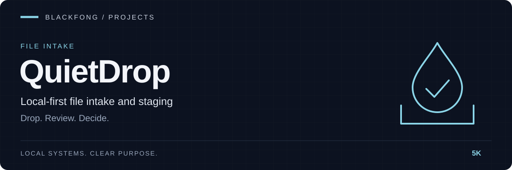

<div align="center">



**Local-first file intake and staging.**


[](https://github.com/5K-bit/QuietDrop/actions/workflows/obeos-component-ci.yml)

[Install](#install-dev--local) · [Quick start](#quick-start) · [Configuration](#config) · [CLI](#cli-mvp)

</div>

---

# QuietDrop

| Collect | Review | Archive |
|---|---|---|
| Watched folders and one-shot scans | Inspect, tag, rename or reject | Move reviewed files into local storage |

Local-first file intake and staging.

Drop files in a folder. QuietDrop notices. You decide what happens next.

## Install (dev / local)

From this repo:

```bash
python3 -m pip install -e ".[dev]"
```

## Quick start

Create config + DB and set your watched folders:

```bash
quietdrop init --watch "/path/to/drop" --archive "/path/to/archive"
```

One-shot scan (polling fallback):

```bash
quietdrop scan
quietdrop list --status new
```

Review + archive:

```bash
quietdrop review 1
quietdrop archive 1
```

Run the watcher as a local service (watchdog + polling safety net):

```bash
quietdrop run
```

Start the web UI + JSON API:

```bash
quietdrop serve --host 127.0.0.1 --port 8844
```

Then open `http://127.0.0.1:8844/`.

## Config

QuietDrop reads a TOML config from:

- `QUIETDROP_CONFIG` (if set), otherwise
- `~/.config/quietdrop/config.toml` (or `XDG_CONFIG_HOME`)

Example:

```toml
watched_folders = ["/home/you/Drop"]
archive_folder = "/home/you/QuietDropArchive"
poll_seconds = 2.0
recursive = false
settle_seconds = 2.0
```

## CLI (MVP)

- `quietdrop status`
- `quietdrop list [--status new|reviewed|archived|rejected]`
- `quietdrop review <id>`
- `quietdrop archive <id>`
- `quietdrop reject <id>`
- `quietdrop rename <id> <new_name>`
- `quietdrop tag <id> <tag...>`

## Terminal identity

`quietdrop --version` prints the installed version (source version when running an uninstalled checkout). Help identifies QuietDrop as a Blackfong project. Interactive commands display a compact product banner on stderr; automatic banners are suppressed when either output stream is redirected. Use `--no-banner` to suppress it or `--banner` before a subcommand to request it explicitly. `NO_COLOR` and `TERM=dumb` disable banner colors. Command output, exit codes, and operational status labels retain their meaning.
